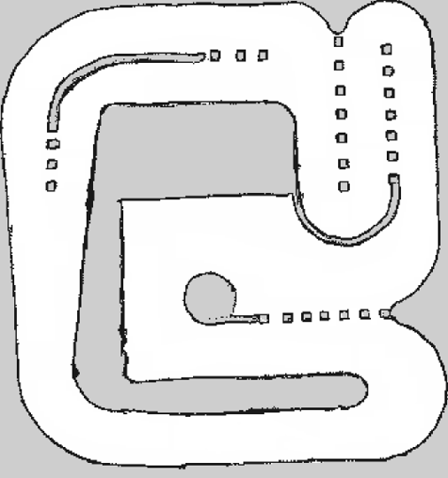
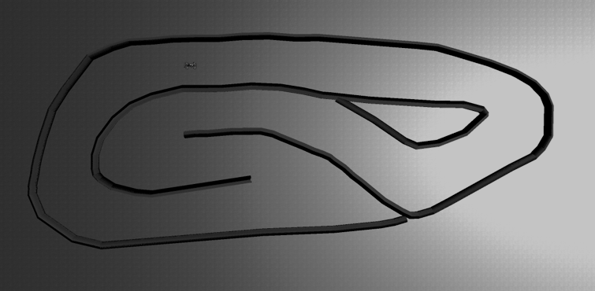

# RoboRacer Autonomous Racing — Track 1

**NTU DeepSpeed Recruitment Hackathon 26/27**

Write the software that drives a 1/10-scale racing car around a circuit it has
never seen, as fast as it can, without hitting anything. Everything you need —
the simulator, the judging environment, reference algorithms and every official
track — is in this repository. You will not need to clone anything else.

> **Submission deadline: 18 October 2026, 23:59 (SGT)**

---

## Quick start

```sh
git clone --recurse-submodules https://github.com/NTUDeepSpeed/Recruitment_Hackathon_2627.git
cd Recruitment_Hackathon_2627
git checkout track1

./install/linux/setup.sh          # or install/macos, or install/windows from WSL
./install/linux/run.sh            # builds if needed, then drops you into the container
```

Then, inside the container:

```sh
cd /hackathon/race_ws && colcon build --symlink-install
source install/local_setup.bash

# Terminal 1 — the simulator
ros2 launch roboracer_referee simulator.launch.py

# Terminal 2 — your car
ros2 run team_driver driver
```

The car will set off and hit the first wall: the template is wiring, not a
driver, and writing one is the hackathon. Once yours does something, score
it:

```sh
./scripts/evaluate.sh --team your_team_name
```

Pushing also races your entry on GitHub Actions and writes the result to the
workflow summary. That workflow is for reference only — it runs on GitHub's
hardware and nothing it prints is scored. **Your result is the organisers' run
on the judging machine.**

Full walkthrough: **[docs/01-setup.md](docs/01-setup.md)**.

> Cloned without `--recurse-submodules`, or downloaded a ZIP? Run
> `git submodule update --init --recursive`. The setup scripts will also do it
> for you. A ZIP download will not work — submodules need a real clone.

---

## The challenge

You get a LiDAR scan and the car's exact position. You publish a steering angle
and a speed. That is the whole interface.

| | |
| --- | --- |
| **Car** | Ackermann steering, 0.33 m wheelbase, 0.31 × 0.58 m, steering limited to ±0.4189 rad |
| **Sensor** | 819-beam LiDAR, 270° field of view, 25 m range |
| **Localisation** | Ground-truth pose on `/ego_racecar/odom` — **allowed and recommended** |
| **Track** | `icra26`, in this repository. 17 x 18 m, about 78 m a lap, cone slaloms and a hairpin complex. |
| **Scored on** | Your single fastest lap, and your time for 10 consecutive laps |
| **Penalties** | +10 s on the lap for each collision; more than 10 collisions is a disqualification |
| **Judged on** | One machine: i9-14900HX, 32 GB, RTX 5060 Laptop. Times are in simulated seconds, so your own hardware does not affect your score. |

**No driver ships with this repository.** `team_driver` is wiring — it talks to
the simulator and drives in a straight line into the first wall. Writing
something that laps is the hackathon. Reactive algorithms like follow-the-gap
will get you round; planning against the map and your own position is where the
lap time is; and **replacing the approach outright is encouraged**:
reinforcement learning, MPC, imitation learning, a learned end-to-end policy,
anything you can defend. The environment is ROS 2 Jazzy on Python 3.12 with a
GPU available, so a learned policy is a realistic option.
[docs/04-algorithms.md](docs/04-algorithms.md) is the menu, with what each
approach needs and where each breaks.

---

## Where things are

```
Recruitment_Hackathon_2627/
├── install/                    Setup scripts, one folder per platform
│   ├── linux/  macos/  windows/    setup.sh, run.sh, shell.sh, stop.sh
│   └── common.sh
├── race_ws/src/                The ROS 2 workspace, mounted into the container
│   ├── team_driver/            ★ YOUR CODE GOES HERE — the template does not drive
│   └── roboracer_referee/        The judging environment — do not modify
├── scripts/                    evaluate.sh, leaderboard.py, track_tool.py, …
├── maps/                       The circuit: icra26.pgm, its yaml, tracks.yaml
├── docker/                     Image definition (ROS 2 Jazzy) and compose files
├── external/                   Upstream simulator sources, as git submodules
├── results/                    Where your run results land
├── .github/workflows/          Automated judging on every push
├── docs/                       This guide
└── workshop/                   ROS 2 teaching material from the workshop
```

The one file you are meant to open first:
**[`race_ws/src/team_driver/team_driver/driver.py`](race_ws/src/team_driver/team_driver/driver.py)**

---

## The guide

| Chapter | What is in it |
| --- | --- |
| **[1. Setup](docs/01-setup.md)** | Installing Docker, building the image, first run, troubleshooting |
| **[2. The simulator](docs/02-simulator.md)** | Topics, message types, changing tracks, RViz, ground-truth odometry |
| **[3. ROS 2 primer](docs/03-workshop.md)** | Nodes, topics and the workshop slides, if ROS is new to you |
| **[4. Algorithms](docs/04-algorithms.md)** | The menu: reactive, planned, model-based and learned — what each needs and where each breaks |
| **[5. Evaluation](docs/05-evaluation.md)** | Scoring yourself, reading result files, how judging day runs |
| **[6. Rules](docs/06-rules.md)** | The rules, the scoring formula, and what gets you disqualified |
| **[7. Submission](docs/07-submission.md)** | What to hand in, how, and what the interview covers |

---

## Rules at a glance

The full rules are in **[docs/06-rules.md](docs/06-rules.md)** and they are what
counts. The short version:

- **Teams of 3 to 5.**
- **Deadline: 18 October 2026, 23:59 SGT.** Late entries are not scored.
- **AI assistants are allowed.** You will be asked to explain your code at the
  interview — generally, not line by line — so do not submit anything you
  cannot defend. A learned policy is held to the same standard, and meets it
  the same way: explain how you trained it and why, not what each weight
  means.
- **Do not modify the judging environment.** Check yourself with
  `./scripts/verify_judging_env.sh`.
- **Score (out of 100):**

  | | Weight | Formula |
  | --- | --- | --- |
  | Fastest single lap | 50 | `50 × (fastest lap of any team ÷ your fastest lap)` |
  | 10-lap total | 50 | `50 × (fastest 10-lap total ÷ your 10-lap total)` |

  One warm-up lap is granted before timing starts. Each collision adds 10 s to
  the lap it happened on. More than 10 collisions in a run is a
  disqualification.

- **Bonus marks** at the interview, for work you can explain properly:
  replacing the ground-truth odometry with your own localisation; generating a
  racing line from the map at runtime; or an ambitious driving algorithm —
  reinforcement learning, MPC, imitation learning.
# NTU DeepSpeed Recruitment Hackathon 26/27

**Drive fast. Don't crash.**

Write the software that drives a 1/10-scale racing car around a circuit it has
never seen, as fast as it can, without hitting anything. Two tracks, two
simulators, one problem.

> **Documentation: <https://ntudeepspeed.github.io/Recruitment_Hackathon_2627/>**
>
> **Register your team: <https://forms.cloud.microsoft/r/70KfZ1by9b>** —
> registration closes **24 September 2026, 23:59 (SGT)**
>
> **Submission deadline: 18 October 2026, 23:59 (SGT)**

This branch is the front door. It holds the landing page and the generator that
builds it — **no hackathon code lives here.** Pick a track below and check out
its branch.

---

## Pick a track

<p>
  
  
</p>

| | **Track 1** | **Track 2** |
| --- | --- | --- |
| Branch | [`track1`](../../tree/track1) | [`track2`](../../tree/track2) |
| Guide | [Track 1 docs](https://ntudeepspeed.github.io/Recruitment_Hackathon_2627/track1/) | [Track 2 docs](https://ntudeepspeed.github.io/Recruitment_Hackathon_2627/track2/) |
| Simulator | `f1tenth_gym` + ROS 2 bridge | AutoDRIVE — a Unity binary you download |
| Control | `AckermannDriveStamped` — ask for a speed | `Float32` throttle in [−1, 1] — ask for torque |
| LiDAR | 819 beams, 270°, 25 m | 1080 beams, 270°, 10 m, 40 Hz, plus IMU, encoders and a camera |
| Circuit | `icra26`, 17 × 18 m, 78 m a lap | ICRA 2026 compete circuit, 6.3 × 18.2 m, 54 m a lap |
| Lap timing | Our referee, against a finish line | The simulator's own clock |
| Install | `git clone --branch track1 --recurse-submodules` | Plain clone, then `./scripts/fetch_simulator.sh` |

Track 2 runs the **compete** phase of the
[RoboRacer Sim Racing League @ ICRA 2026](https://autodrive-ecosystem.github.io/competitions/roboracer-sim-racing-icra-2026/)
— the same vehicle, sensors, circuit and devkit the ICRA teams raced. The big
difference from Track 1 is the control interface: there is no speed controller
between your node and the motor, so closing that loop is your problem.

```sh
git clone https://github.com/NTUDeepSpeed/Recruitment_Hackathon_2627.git
cd Recruitment_Hackathon_2627

git checkout track1   # or track2
```

Then follow chapter 1 of that track's guide.

---

## The same for both

The full rules are in chapter 6 of your track's guide and they are what counts.
The short version:

- **Teams of 3 to 5.** One team per person. The roster is fixed at submission.
- **Register by 24 September 2026, 23:59 SGT** —
  [one form per team](https://forms.cloud.microsoft/r/70KfZ1by9b). You can
  start reading, and building, before you send it.
- **Deadline: 18 October 2026, 23:59 SGT.** Late entries are not scored.
- **Score out of 100** — 50 for your fastest single lap, 50 for your 10-lap
  total, both relative to the fastest team.
- **+10 s on the lap per collision.** More than 10 collisions is a
  disqualification.
- **Ground-truth pose is allowed and recommended.** Replacing it with your own
  localisation earns bonus marks at the interview.
- **AI assistants are allowed.** You will be asked to explain your code, so do
  not submit anything you cannot defend.
- **Every push races on GitHub Actions** and writes the result to the workflow
  summary.

Judging runs on one machine — i9-14900HX, 32 GB, RTX 5060 Laptop — and times
come from the simulator's clock, so your own hardware does not affect your
score.

---

## The documentation site

`docs-site/` renders `README.md` and `docs/*.md` from **both** track branches
into one static site and publishes it to the `gh-pages` branch, which GitHub
Pages serves.

The prose stays plain Markdown on the track branches, so it reads correctly on
GitHub too. The site is a build artefact and is never committed to a source
branch.

```
docs-site/
├── build.py           The generator
├── check_links.py     Fails CI on a broken cross-chapter link or anchor
├── site.json          Landing-page copy — tracks, stats, chapter notes
├── requirements.txt   markdown + Pygments
├── templates/         Page shells with {{SLOT}} placeholders
├── theme/
│   ├── tokens.css     DeepSpeed design system, vendored verbatim
│   ├── docs.css       Docs components, built on those tokens
│   └── app.js         Theme toggle, drawer, copy buttons, scrollspy
└── static/            Favicon, circuit maps, anything else copied as-is
```

### The platform switch

The site carries a Linux / macOS / Windows switch, and every documented command
follows it. Two things drive it, both detected from the prose — **no special
Markdown syntax, and nothing to maintain by hand**:

- Any `install/<platform>/…` path in a command becomes all three variants, and
  CSS shows the one for the reader's platform. Copy buttons give the right
  command because `innerText` skips what is hidden.
- A run of consecutive per-platform `###` headings (as under *1.2 Install
  Docker*) becomes one switchable group, and the contents list follows it.
- A heading that names its platforms in brackets — *1.6 Running the simulator
  on your host (macOS, Windows)* — gets a note telling everyone else they can
  skip it. The section stays visible, because the prose cross-references these
  by number.

Nothing is rewritten at run time: every variant ships in the HTML, so the page
is correct before the JavaScript loads. The choice is remembered per reader,
and defaults to the OS they appear to be on. The switch sits in the header at
every width, and again in the sidebar, in the landing hero and beside the
per-platform sections.

The stylesheet and the script are published under a content hash
(`docs.<hash>.css`). GitHub Pages serves everything with `max-age=600`, so
without that a returning reader could hold a ten-minute-stale stylesheet
against fresh HTML — which is exactly how a CSS-driven feature looks broken.

Keep writing the Markdown for a GitHub reader, who has no switch. A line like
`./install/linux/setup.sh  # or install/macos, …` is right there and the site
hides the redundant half.

### Build it locally

```sh
git worktree add ../t1 track1
git worktree add ../t2 track2

python3 -m venv .venv && . .venv/bin/activate
pip install -r docs-site/requirements.txt

python docs-site/build.py --out _site --src track1=../t1 --src track2=../t2
python docs-site/check_links.py _site
python -m http.server -d _site 8000
```

### How it publishes

[`.github/workflows/docs.yml`](.github/workflows/docs.yml) rebuilds and
publishes on every push to `main`, `track1` or `track2` that touches
`README.md`, `docs/`, `docs-site/` or the workflow itself. The same file exists
on all three branches because GitHub runs the copy on the branch you pushed to
— **keep the three copies in step.**

The job is guarded by `if: github.repository == 'NTUDeepSpeed/…'`, so teams who
fork this repository to compete never spend their Actions minutes rebuilding
our documentation. (`judge.yml` is deliberately *not* guarded — racing your
entry on every push is the point of a fork.)

### Design

The site uses the **DeepSpeed design system**: monochrome foundation, race-red
`#E2342B` as the only accent, Anton for headlines, Space Grotesk for body,
JetBrains Mono for telemetry and labels. Dark is the default theme.

`theme/tokens.css` is vendored verbatim from that system — re-export over it to
update. Everything in `theme/docs.css` reads those custom properties and
contains no raw brand values, so re-skinning is a one-file swap.

`static/favicon.png` is the team's own favicon, copied byte for byte from
[NTUDeepSpeed.github.io](https://github.com/NTUDeepSpeed/NTUDeepSpeed.github.io)
(`public/favicon.png`) and declared the same way. Do not regenerate it — if the
team changes theirs, copy the new file over. The mascot appears nowhere else:
the design system's rule is that the lion is a logo, not a UI icon, and the
favicon is one of the two places it is allowed below 64px.

---

## Getting help

- Check the troubleshooting section at the end of
  [docs/01-setup.md](docs/01-setup.md) first — most problems are there.
- Bring the exact error text and what you ran to the team channel.
- `./scripts/verify_judging_env.sh` will tell you if your environment has
  drifted from the official one.
- You may email `ntu-deepspeed@e.ntu.edu.sg` for further inquiries if you cannot solve the issues after troubleshooting.
- Read the troubleshooting section at the end of chapter 1 for your track
  first — most problems are there.
- Bring the exact error text and what you ran to the team channel.
- Email `ntu-deepspeed@e.ntu.edu.sg` if troubleshooting has not got you there.

Good luck. Go fast.
